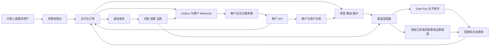

# MojoPay 全球支付通道系统

产品与技术设计 · v0.1 · 2026-11-27

## 1. 产品定位

MojoPay 为下游商户提供统一的收款、退款、换汇结算和出款服务。商户通过一套 API、商户后台和托管收银台接入。MojoPay 根据商户、最终用户、支付方式和交易条件，选择已获授权的上游账户及通道，处理支付结果、记账、对账和结算。

- **上游**是 Gate Pay 等支付及资金服务商。MojoPay 按合作主体和环境开户，使用上游主账号及机构子账号。外部余额、链上交易、银行出款和渠道流水由实际执行的上游记录。
- **下游**是电商、企业服务、数字商品平台、游戏商、具备下游服务资格的 PSP 等。MojoPay 为商户建立主账号、子账号、独立 API 凭证及可查看的虚拟账本。
- **最终用户**是付款人、收款人或游戏玩家。MojoPay 可在获授权的商户范围内识别用户，并根据业务和地区要求触发验证。终端用户默认没有可提现的 MojoPay 余额。
- **资金边界**是上游账户中的资产与 MojoPay 内部账本分开。账本记录商户权益、冻结、在途和已结算金额。银行账户和链上地址由上游或获准的资金服务方执行出入金。资金权属、清算责任、是否可使用汇集账户及保障安排由经营主体和通道合同确认，产品页面按已确认口径展示余额。

首要交付是按商户开通、按子账号路由、按币种记账、可对账、可结算的交易闭环。全球覆盖按**商户所在地、付款人地区、支付方式、收款资产、结算资产和出款目的地**逐条开启。

## 2. 上游参考与下游产品能力

[随仓库提供的 Gate Pay 介绍](gate.pay) 用于梳理能力。签约产品权限和沙盒、生产的回归结果决定 MojoPay 的可用范围。

| 能力 | Gate Pay 参考能力 | MojoPay 产品设计 |
| --- | --- | --- |
| 链上加密收款 | 动态地址与订单关联，资料列明绑定 30 天；静态地址长期有效，可在后台创建收款码 | 首期按订单生成地址及二维码。配置币种、网络、确认要求和支付有效期。后续支持可复用收款码和静态地址入账识别 |
| Gate 账户支付 | Gate App 扫码、浏览器跳转及 SDK 调起 | 托管收银台按通道能力展示支付方式。Gate 扫码面向 Gate 用户，自托管钱包使用可用的链上支付方式 |
| 法币收款 | Stripe、墨西哥 SPEI、部分非洲本地支付方式，具体地区、币种、审核要求不同 | 按合同上架卡、转账及本地方式。能力矩阵控制地区、币种、限额、争议处理和结算周期 |
| 结算与换汇 | 账户余额、数字资产闪兑和流水；Gate 有独立法币提现开通流程 | 报价、换汇记账、商户结算及出款分开。BTC↔法币由已验收的兑换和出款链路实现，必要时由多个获准上游组合完成 |
| 链上代付、提现和退款 | 链上出款、手续费查询、内扣或外收、风险检测，以及退款接口 | 商户提现、受许可的代付、原交易退款分别建单。校验目的地并记录手续费口径，支持审批及状态追踪 |
| 机构子账号 | 单独收款、提现和划转，主子账号及子账号间可资金流转 | 上游主子账号管理、授权、余额及对账隔离。每条下游绑定限制到具体上游子账号及能力 |
| 订阅 | USDT、USDC 的固定周期扣款或授权扣款，附件列出 Ethereum、Arbitrum、Polygon、BSC | 后续可开放授权、扣款、取消和 Webhook。Gate 此项以其托管收银台为准，前端展示上游跳转提示 |
| 资金管理 | 查询余额、费用、收单流水、运营角色和余额收益 | 首期提供余额与流水、对账差异、权限及审计。余额收益暂不作为商户支付产品 |

Gate Pay 公共资料的覆盖范围和具体签约主体相关。已查到的法币提现指南描述的是商户后台操作，包含审核和收款账户要求。**Gate 子账号能否通过 API 向指定下游银行账户付款、能否完成对应 BTC↔法币兑换、是否允许以 PSP 模式上架**，需在生产验收前逐项签字确认。 [Gate Pay 产品页](https://www.gate.com/pay) · [机构账号文档](https://www.gate.com/docs/gatepay/institution_account/en/) · [法币提现指南](https://www.gate.com/help/gatepay/merchant_integration_guide/44116)

### 2.1 支付资产和结算资产独立配置

每笔交易区分 `order_currency`（商品标价）、`payment_asset`（付款资产及网络）、`provider_received_asset`（实际收款资产）和 `settlement_asset`（商户结算资产）。页面和 API 同时显示金额、费用、报价有效期、本次允许的支付方式及预计结算时间。

- **BTC → USD 等法币**。客户用 BTC 支付，MojoPay 确认链上入金及风控结果，再按有效报价完成兑换。商户获得法币待结算余额，到期后通过已开通的法币出款渠道付至审核通过的银行账户。
- **法币 → BTC**。客户通过已开通的法币方式付款。待上游确认资金可结算、处理退款及拒付风险后执行兑换，记账为 BTC，随后从具备出款能力的上游子账号提至商户审核通过的 BTC 地址。
- **同资产及其他币对**。同币种收付可省略换汇。稳定币、其他公链和更多法币按能力矩阵逐项开放。资产代码及网络分别校验，例如 USDT 在不同网络使用独立通道和地址规则。
- **报价合同**。报价带来源、汇率、费用、方向、更新时间、有效期及保价条件。可以按报价固定支付金额，也可以按实际换汇结果结算，具体由商户签约方案决定。保价需确认上游报价可执行或有已批准的流动性。过期、少付、多付和实际成交偏差进入异常处理，不能自动从另一商户余额补差。

## 3. 账号、绑定与权限

| 对象 | 关系与默认权限 |
| --- | --- |
| `provider` / `provider_account` | 一个上游有多个主账号。每个主账号可有多个机构子账号，保存外部账号标识、账户用途、环境、凭证引用、权限和状态。运营登录子账号单独管理 |
| `merchant` / `merchant_account` | 主账号代表签约商户。子账号代表品牌、店铺、应用、地区或业务线。主账号管理员可在授权范围内查看多个子账号，子账号只能操作本账号订单、资金和配置 |
| `merchant_user` | 商户提供 `external_user_id`，按商户范围唯一，必要时关联实际付款人或收款人。跨商户共享身份及验证结果需另行授权 |
| `channel_capability` | 上游子账号的能力配置，区分收款、退款、换汇、划转和出款。覆盖收付地区及币种、链、产品、限额、支持的前端模式及结算周期 |
| `channel_binding` | 商户账号与上游子账号多对多授权。记录能力、商户主体、用途、优先级、权重、限额、费率、有效期和配置版本 |
| `beneficiary` | 商户审核通过的银行账户或链上钱包。受益人、币种、国家、银行清算方式及链均需匹配出款权限 |

主账号可配置可下发能力及审批边界，子账号在该范围内单独配置绑定。未显式授权到子账号的通道默认不可用。商户后台可统一看报表，资金归属仍按实际账号记账。新增绑定、提现地址变更、凭据轮换和额度提升记录审批人及生效时间。上游子账号如需为多个商户服务，应由合同明确允许并完成独立分账验证。

## 4. 业务模块和后台

| 模块 | 关键功能 |
| --- | --- |
| 上游管理 | 供应商和环境、主子账户、权限审批、API 凭证引用、币种及网络、产品开通、费率限额、余额、划转、账单下载、证书与回调健康 |
| 商户管理 | KYB 进件、主子账号、人员角色、品牌配置、受益账户、API Key、Webhook、通道绑定、合同费率、额度及对账单 |
| 合规与风控 | 商户和最终用户尽调、名单及地区校验、交易监控、链上 KYT、异常工单、人工复核、解除冻结及审计 |
| 收款与收银台 | API/人工建单、支付链接、网络和方式选择、动态地址、白标/跳转、费用及报价展示 |
| 订单中心 | 订单和渠道尝试、支付交易、状态时间线、支付凭证、超时、少付、多付、错链、退款、拒付、异常补单 |
| 路由与报价 | 能力矩阵、主备优先级、权重、试运行、限额、通道健康、路由解释、汇率报价及换汇执行 |
| 资金与账本 | 商户多币种账户、上游余额、在途资金、费用、保证金、冻结、会计分录、财务复核和控制总额 |
| 结算与出款 | 结算周期、批次、出款申请、审批、余额预占、上游提现或代付、出款跟踪及凭证 |
| 对账与报表 | 上游余额及流水对账、商户结算单、订单手续费及净额、差异工单、财务导出、通道收益和成功率 |
| 运营与开发者 | 沙盒、API 及事件日志、重放工具、回调告警、权限与审计、通道停用、账户限流、数据导出 |

### 4.1 收银台及品牌

商户通过 API 或后台获取短期支付链接，也可将链接嵌入获授权的站点。收银台支持 **MojoPay 品牌**和**商户白标**，商户可配置 Logo、名称、配色、语言及已验证域名。用户可查看商品信息、订单金额、可用方式、付款码或地址、币种和链、到期时间及处理进度。卡资料、实名材料或上游授权若需要在持牌服务方页面采集，MojoPay 负责跳转和结果展示。前端跳转返回仅用于展示，商户发货依据签名 Webhook 或主动查单。

## 5. 关键业务流程

### 5.1 进件与身份验证

1. 商户提交 KYB 材料，包括注册实体、经营地区及业务类别、官网或 App、受益所有人及授权代表、资金来源和预计交易规模。由 MojoPay 审核，按通道要求提交上游审核。
2. 商户验证结果按**主体、产品、国家、用途和通道**记录。企业审核通过后，仍需完成上游账户开通、商户绑定及权限配置，方可放量。
3. 最终用户按风控策略核验。商户调用用户接口后拿到 `kyc_session_id` 或引导链接。按交易方向、币种、金额、国家和收款方式决定是否补充验证。能复用的结果必须符合本次授权和有效期；流程支持待补件、通过、拒绝、过期和复核。
4. 收款、换汇和出款前执行各自的策略。链上资产按通道及规则执行地址与交易风险检查。需要时收集资金来源、收款人信息及 Travel Rule 数据。数据加密和权限隔离，支付日志只存引用和必要的审计字段。具体义务、适用阈值和保存期限由经营主体、合作方及目标市场评估确定。 [FATF 虚拟资产风险评估指南](https://www.fatf-gafi.org/en/publications/Methodsandtrends/quick-guide-on-assessing-ML-risks-of-VA-and-VASPs.html) · [FATF 支付透明度标准更新](https://www.fatf-gafi.org/content/fatf-gafi/en/publications/Fatfrecommendations/update-Recommendation-16-payment-transparency-june-2025.html)

### 5.2 收款与加权路由

1. 校验商户身份、子账号权限、幂等键、标价、付款人条件及业务类别。生成 MojoPay 订单。
2. 按已生效绑定、地区、币种/网络、支付方式、品牌模式、商户及用户审核、金额区间、上游单笔/当日额度、服务状态和结算可达性过滤。
3. 在同优先级可用通道内按配置权重选取，上游账户和策略版本写入 `payment_attempt`。例如 A 和 B 的权重为 70 和 30，表示在两条都可用时预计分配约 70% 和 30% 的**订单笔数**。权重不拆分一笔交易。固定指定通道只在绑定及资格校验通过时使用。
4. 用唯一渠道请求号调用已选上游，结果可包含地址、二维码、托管页面或跳转参数。回调、主动查单和对账按原尝试归属。已展示付款指令或上游受理结果不明时，先查单、处理或确认关闭原尝试。已安全终止的尝试才可启用后备通道，避免同一订单产生两次有效收款。
5. 上游支付确认后根据币种和渠道更新支付状态；若仍等待链上确认、KYT、换汇或清算，资金显示在相应的待处理余额中。支付确认、商户资金可用和出款完成分别通知。

没有可用通道时向商户返回可解释原因，例如 `NO_ELIGIBLE_CHANNEL`、`KYC_REQUIRED` 或 `AMOUNT_LIMIT_EXCEEDED`。运营可查候选、拒绝原因、版本及最终通道，商户看到业务级原因以及如何补充信息。

### 5.3 结算与提现

1. 结算从可用余额生成按商户子账号、币种、周期和资金来源划分的明细。根据净额、手续费、准备金及退款抵扣生成结算单。可支持定期自动结算和商户主动提现。
2. 提现验证受益人、结算币种及网络、额度、可用余额、上游可用资产和当前审批策略。事务内冻结商户余额；需要从上游子账号划转至出款账户时，单独生成划转单并对账。
3. 用唯一出款指令调用出款渠道，记录对应上游账户、手续费模式、真实执行币种、外部单号、银行参考号或链上哈希，并异步查询终态。
4. 上游确认成功后核销冻结和上游在途。已确认失败时解冻。超时或结果不明时继续冻结并转人工，按原请求号查询，防止重复出款。出款退回单独入账并通知商户。

**商户提现**付给商户审核通过的账户。**商户代付**指向商户的最终收款人，需要独立产品授权、用途及收款人检查。**退款**归属于原支付，按原渠道允许的方式返回给原付款方，带原订单和累计退款上限。退款资产、手续费、差额和金额锁定以签约规则和原订单快照为准，拒付和退款都能进入商户准备金或追偿流程。

### 5.4 后台手动创建一笔大额订单

商户财务可在后台创建**单笔、指定金额**的支付订单，填写付款对象、合同或发票编号、付款与结算币种、用途及到期时间。按金额分档要求商户内部审批、MojoPay 风控复核、交易来源材料或最终付款人 KYC。通过后生成单次支付链接，可限制付款人访问。只选择能完整承接金额的通道，单笔限额不够时进入人工处理。链上少付、多付和超期到账仍归集到原订单异常队列，财务可审核补款、退款或按规则接纳，重复支付不会生成第二笔商品订单。

### 5.5 游戏商及数字商品

游戏商按游戏、区服、地区或发行品牌建子账号，上传商户业务类别及站点资料。下单携带 `external_user_id`、商户订单号、SKU 及必要的商品说明，服务端校验价格，前端价格仅用于展示。支付达成商户设置的发货条件后，MojoPay 发出签名事件，游戏商以 `order_id` 幂等发放虚拟道具或游戏余额。拒付、重复付款和退款通过独立事件联动回收或争议处理。

普通游戏道具和可转让、可兑现资产使用不同业务分类。具备提现、交易或博彩属性的商品按地区及合作方规则单独评估，未获批准不开放。风险策略可覆盖未成年人、设备频次、账号盗用、跨区异常和高额充值。游戏商对商品交付负责，MojoPay 记录交易与结算。

## 6. 技术设计

### 6.1 应用结构与数据流

首期使用模块化 Go 应用，沿用 mojopay 现有的 HTTP 与 Bot 启动结构。HTTP 接收商户请求、收银台请求和上游回调。Bot 处理事件投递、主动查单、对账及结算。两种进程通过 MySQL 和持久任务表协作，可按负载独立部署。



- `interfaces/rest` 承载商户 API、收银台和渠道回调。运营端与商户端权限独立。
- `application/core-service` 承载商户进件、支付、路由、报价、风控、账本和结算用例。`application/bot/scripts` 承载查单、事件重发、对账和结算任务。
- `domain` 定义状态、金额、账本及渠道能力契约；`infrastructure/http` 实现 Gate Pay 及后续适配器；`infrastructure/mysql` 实现事务、存储和任务租约；`boot` 使用构造注入。
- 渠道适配器按能力实现 `CreatePayment`、`QueryPayment`、`Refund`、`Quote/Convert`、`Transfer`、`CreatePayout/QueryPayout`、`GetBalance/FetchStatement` 及回调验签。遇到能力缺失时显式返回错误。商户 API 统一状态和错误码，原始响应脱敏后供运营核查。

### 6.2 数据模型和状态

| 实体 | 设计重点 |
| --- | --- |
| `payment_order` / `payment_attempt` / `payment_receipt` | 商户账号 + 外部订单号唯一；记录上游子账号、路由快照、提供方请求号、网络、到账分笔和确认时间；上游流水按提供方及账号去重 |
| `quote` / `conversion` | 记录报价方向、币对、买卖金额、来源、有效期、实际成交、偏差及费用；锁定原订单引用 |
| `compliance_case` / `beneficiary` | 关联商户、最终用户或交易，保存审核范围、证据引用、决定及版本 |
| `refund_order` / `dispute_case` | 关联原交易、反向资金来源、费用、部分退款累计及拒付状态 |
| `ledger_account` / `journal` / `journal_entry` | 币种、科目、商户/上游归属、业务事件唯一键、借贷分录及冲正引用 |
| `settlement_batch` / `settlement_item` / `payout_order` / `transfer_order` | 记录资金来源、冻结分录、受益人、上下游单号和对账状态；出款和划转独立编排 |
| `provider_event_inbox` / `merchant_event_outbox` / `recon_item` | 记录接收去重、投递重试、商户事件号、渠道账单行、差异金额和人工工单 |

支付可依次经过 `CREATED`、`AWAITING_PAYMENT`、`PROCESSING`、`PAID`；未支付可进入 `EXPIRED`、`CANCELLED`、`FAILED`，晚到或异常通过 `REVIEW` 处理。已确认付款的订单保留支付事实，退款、拒付和结算各有独立状态。结算可经过 `PENDING`、`AVAILABLE`、`ON_HOLD`、`IN_PAYOUT`、`SETTLED`，部分出款按结算明细累计。出款超时记为 `UNKNOWN` 并持续查单。

### 6.3 虚拟账本与对账

- 按资产设科目，使用整数最小单位或定点十进制。区分商户待结算、可用、冻结、出款在途，以及上游资产、汇兑清算、通道费用、平台收入和差异暂记。
- 每笔变动以业务事件唯一键入账，同一资产的借贷相等。订单、账本和 Outbox 的状态提交使用同一数据库事务。修正历史用反向分录和重新入账，报表保留来源。
- 兑换用关联的两组分录表达两个资产。示例仅用于说明记账，假设收到 BTC 0.10000000，实际换得 USD 6,000.00，MojoPay 商户费为 USD 60.00，其他费用为零。依次记录 BTC 收款及 BTC 义务、BTC 换出及义务结清、USD 换入及商户待结算 USD 5,940.00 和平台收入 USD 60.00。USD 出款最终成功时扣减商户应付和对应渠道 USD 资产。两条资产流水均关联同一换汇单。
- 按上游账号、币种和账单日校验**期初余额 + 净发生额 = 期末余额**。对照业务订单、内部凭证和上游真实流水，识别缺单、重单、手续费、汇率、在途和归属差异。交易号、链上交易哈希加输出序号、金额、币种和状态为主要匹配字段。差异占用的余额单独冻结，待人工审批和凭证核实后解除。
- 同一商户多个上游子账号的账面余额可在报表汇总，出款时按真实资金位置拆分内部资金来源并校验流动性。实际划拨需要上游指令；未经授权不得用其他商户的余额垫付。

### 6.4 API 与可靠性

| 建议接口 | 说明 |
| --- | --- |
| `POST /api/v1/merchants/onboardings`、`POST /api/v1/merchants/{id}/accounts` | 支持合作方进件和主子账号创建，按调用方权限授权 |
| `POST /api/v1/users/kyc-sessions`、`GET /api/v1/users/kyc-sessions/{id}` | 最终用户实名及查询审核状态 |
| `GET /api/v1/payment-methods`、`POST /api/v1/quotes` | 发现可用通道组合及报价 |
| `POST /api/v1/payment-orders`、`GET /api/v1/payment-orders/{id}` | 建单返回 MojoPay 单号、状态、支付链接和到期时间 |
| `POST /api/v1/payment-orders/{id}/refunds` | 校验累计可退额、原通道和退款政策 |
| `GET /api/v1/balances`、`GET /api/v1/settlements`、`GET /api/v1/statements` | 查询可用、冻结及在途余额、结算和对账明细 |
| `POST /api/v1/payouts`、`GET /api/v1/payouts/{id}` | 申请商户提现或获授权代付，跟踪真实出款 |
| 商户 Webhook | `payment.paid`、`payment.review_required`、`kyc.updated`、`refund.updated`、`settlement.available`、`payout.updated` |

下面是商户发起 BTC 收款、USD 结算的建单示例。金额用字符串表达，BTC 应付份额由报价返回；订单状态和出款状态独立查询。

```json
{
  "merchant_account_id": "ma_store_01",
  "merchant_order_no": "INV-2026-001",
  "amount": "6000.00",
  "order_currency": "USD",
  "payment_asset": {"code": "BTC", "network": "BITCOIN"},
  "settlement_asset": {"code": "USD"},
  "quote_id": "qt_example"
}
```

- 写接口按商户账号、操作和 `Idempotency-Key` 去重，相同请求重放同一结果，参数不同返回冲突。每次上游尝试有唯一指令号；超时查单优先于重试。
- 上游回调使用官方签名协议和重放保护。验签、验证账号与交易归属、写入 Inbox 后再按渠道协议确认。Gate Pay 要求收到成功确认；回调失败可能重试，主动查单用于恢复遗漏。 [Gate Pay 公共 API 与异步通知](https://www.gate.com/docs/gatepay/common/en/)
- 商户回调携带唯一 `event_id`、版本、签名和时间戳，允许重试、重复和乱序。商户可幂等消费和主动查单。失败事件在运营端可审计重放。
- 资金操作按账户、币种使用事务和预占。任务带持久租约及重试记录。缓存存热点或限流数据，历史资金事实保留在账本和对账记录中。
- Key 与证书进入密钥管理服务，按环境、通道、主子账户和权限范围隔离。出款账号和通道启停采用双人复核。告警关注回调延迟、路由可用率、冻结/在途时长、对账差异和实际出款异常。

## 7. 交付计划与验收

| 阶段 | 交付及出口条件 |
| --- | --- |
| P0 通道验证 | Gate Pay 主子账号、沙盒及生产权限、API 及回调、BTC 链、法币在目标市场的收/出款、跨资产兑换、清算周期及账单。拉通两个方向所需的资金链；缺口指定其他获准上游或暂不上架 |
| P1 商户收款与结算 | 主子账号、KYB/按需最终用户 KYC、通道绑定及权重、托管收银台、链上收款及已验收的法币方式、退款、双分录账本、结算报表、提现审批、对账及后台单笔大额订单 |
| P2 规模化 | 增加其他上游、商户白标域名、更多地区及资产、游戏商接入模板、批量出款、自动对账策略、更多拒付及风险运营能力 |
| P3 扩展 | 稳定币订阅、静态地址/POS、更多换汇组合及商户自助开通 |

首期按通道和商户灰度。至少验收以下用例：

1. 同一商户子账号绑定两家上游的多个子账号，权重按订单生效，额度或风控不满足的账户不会被选中，重复请求仍指向同一个 MojoPay 订单。
2. BTC→法币和法币→BTC 均可追溯到原收款、实际换汇、虚拟账本、商户结算单和真实出款凭证。每个方向仅对通过实际清算链路验收的国家及币对开放。
3. 重复回调、渠道超时、支付延迟、多付、部分退款、拒付和提现不明都能恢复或进入人工工单，账本无重复记账及重复出款。
4. 手工大额订单与 API 订单使用同一审批、账本及对账能力。游戏商收到重复成功事件只交付一次。跨租户 API 权限、子账号资金隔离、提现限额和凭证轮换通过测试。
5. 商户能下载结算单和费用明细，运营能从订单追到路由原因、渠道账号、资金位置及人工处理记录。对账差异及提现未知状态能够在后台识别并跟进。

上线评审需确定经营及签约主体、首发国家和币对、受益人范围、支付及换汇定价模式、商户费率与准备金、清算及出款时限、允许的游戏业务范围、Gate Pay 与其他上游承担的职责，以及异常处理和资金损失归属。以上决策落为可审计的渠道能力和商户合同配置。
