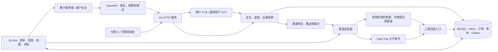
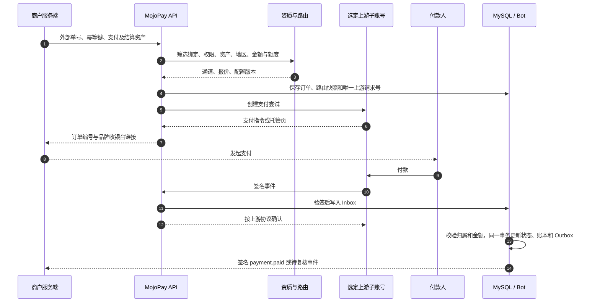
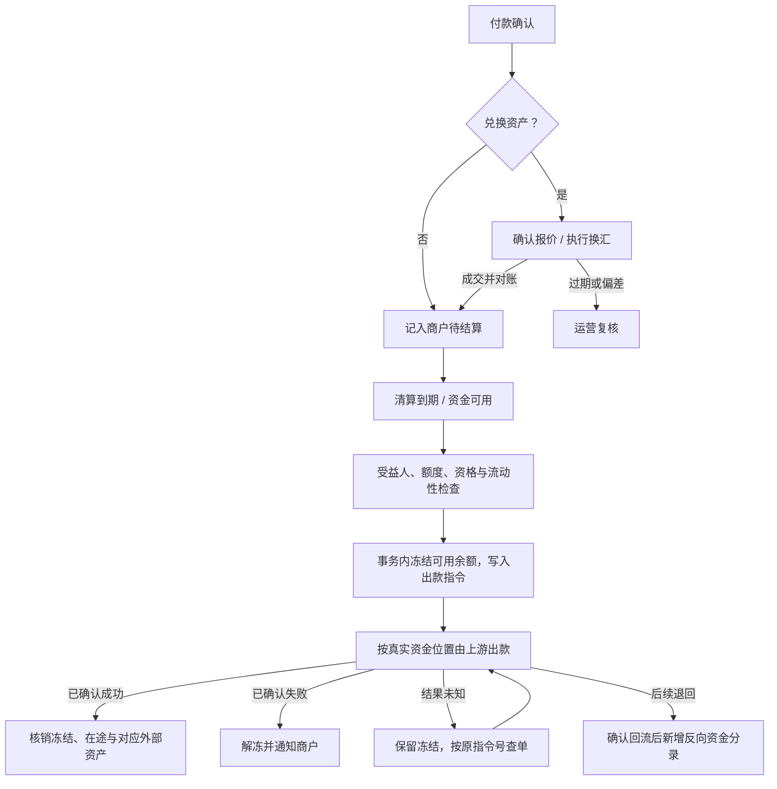
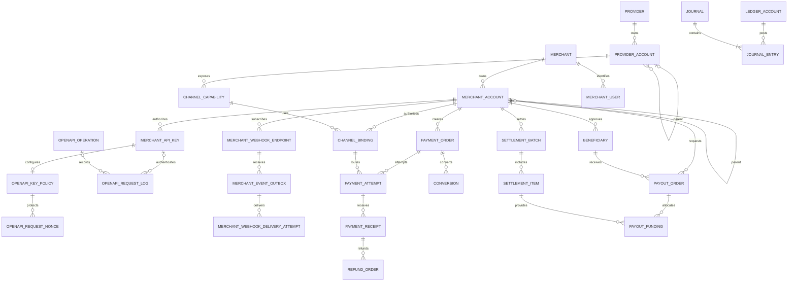
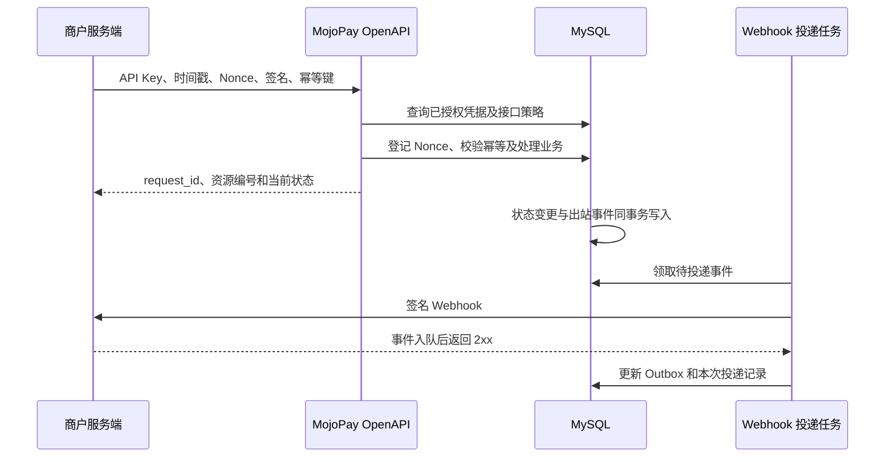

# MojoPay 全球支付通道系统 · 技术设计

设计草案 · MySQL 8.0 · 现有 Go 工程

[产品功能](mojopay-product-features.md) 定义商户侧能力。[Gate Pay 接入资料](gate.pay) 用于规划首个渠道适配器。本文件给出目标结构和数据契约，表结构是建库设计，供后续迁移评审。

## 1. 应用架构



| 工程目录 | 职责 |
| --- | --- |
| `interfaces/rest` | 商户 OpenAPI、运营 API、托管收银台、上游回调，复用现有 Router 启停结构 |
| `application/core-service` | 账号与进件、交易编排、加权路由、报价、风控、账本、对账及出款用例 |
| `application/bot/scripts` | 主动查单、回调重投、账单拉取、结算生成及差异处理，使用 MySQL 任务租约 |
| `domain` | 金额、状态机、数据实体、仓储与第三方能力契约 |
| `infrastructure/http` | Gate Pay 及后续适配器，处理签名、幂等单号、异常映射、外部状态 |
| `infrastructure/mysql` / `boot` | 事务、持久化、任务领取及构造注入 |

渠道契约按能力拆分为收款及查询、退款、报价及兑换、划转、出款及查询、余额及账单和回调验签。每项能力与上游子账号、环境、产品权限和清算路径绑定。出款结果的证据来自实际执行的上游或其银行／链上凭证。MojoPay 的交易及账本记录用于追踪商户权益，不创建独立的外部资金余额。

## 2. 交易与出款流程

### 2.1 建单、收银台、落账



1. 按授权绑定过滤候选，约束为地区、金额、币种/链、资格、余额与额度、支付方式和目标资产清算可达性。权重仅在同优先级的合格候选间生效。每次尝试保存选中绑定版本及候选处理原因。
2. 上游超时使用原请求号查单，订单仍可能有效。已向付款人展示地址或跳转链接时，原尝试须按渠道规则关闭并确认无款，才能新建可付款尝试。晚到资金仍按原尝试归属并进入异常队列。
3. 加密收款以确认数、币种/网络、金额、归属和风控结果判定。法币支付以渠道的支付与清算状态为准。付款确认、商户资金可用、以及出款确认分别记录。
4. Gate 回调按其签名协议验证，保存成功后返回渠道要求的确认，重复或漏发由 Inbox 和主动查询恢复。 [Gate Pay 公共 API 与异步通知](https://www.gate.com/docs/gatepay/common/en/)

### 2.2 结算、跨资产兑换和提现



BTC→法币从链上确认、KYT、实际换汇开始，最终从有权限的银行出款链路付款。法币→BTC 要确认可结算余额、拒付风险和准备金，再兑换、链上提现。退款回到原交易规则，代付和商户提现使用不同出款类型与审核范围。Gate 法币提现指南的后台流程不能作为子账号法币代付 API 的验收证据。每个上游的 PSP 授权、兑换权限及第三方银行收款权限需单独确认。 [Gate Pay 机构子账号](https://www.gate.com/docs/gatepay/institution_account/en/) · [Gate Pay 法币提现指南](https://www.gate.com/help/gatepay/merchant_integration_guide/44116)

## 3. 数据模型

### 3.1 核心实体关系



### 3.2 字段与约定

- `id` 与所有内部外键均为 `BIGINT UNSIGNED`。表按需加 `created_at`、`updated_at`，使用 UTC 的 `DATETIME(6)`，业务连接池每条连接将 SQL 会话时区设为 `+00:00`。数值状态、资产、日期等分组字段包含于查询索引。
- `money` 代表 `DECIMAL(36,0)`，保存资产最小单位。汇率用 `DECIMAL(38,18)` 表示带方向的比率，记账按资产精度裁剪并单独记录尾差。客户 API 的金额用字符串。以下各表的通用字段省略。
- `asset` 记录 `code VARCHAR(16)`、`kind VARCHAR(12)`、`decimals TINYINT UNSIGNED`，唯一键为 `code`。`asset_network` 记录 `asset_id`、`network_code VARCHAR(32)`、`contract_address VARCHAR(160)`，唯一键为 `(asset_id, network_code)`。网络用于收付渠道校验。同一资产的账本余额按资产核算，真实资金来源按上游账号及链分开追踪。
- 表中 PK 为主键，FK 为外键，UK 为唯一约束。各表以 `id` 为 PK，表中引用列原则上关联同名实体的 `id`。对外 API 使用带前缀的不透明 `public_id VARCHAR(64)`，按表建唯一索引。`?` 表示可空。关联 merchant 的子表都做同租户校验，跨表操作在事务内核对关联对象的商户归属。根账号的 `parent_id` 可空，单主账号约束由商户主账号引用或事务锁实现。上游及商户账号禁用采用状态字段保留历史。

### 3.3 渠道、账号与资质

| 表 | 核心字段 | 约束及索引 |
| --- | --- | --- |
| `provider` | `id`，`code VARCHAR(32)`，`name VARCHAR(128)`，`status VARCHAR(24)` | PK `id`，UK `code` |
| `provider_account` | `id, provider_id, parent_id?`，`environment VARCHAR(12)`，`external_id VARCHAR(128)`，`role VARCHAR(24)`，`credential_ref VARCHAR(255)`，`status VARCHAR(24)` | UK `(provider_id, environment, external_id)`，FK 至上游、父账号，父子环境一致 |
| `channel_capability` | `id, provider_account_id, asset_id, network_id?, settlement_asset_id?`，`operation VARCHAR(24)`，`method VARCHAR(32)`，`region CHAR(2)`，`capability_key VARCHAR(64)`，`min_amount/max_amount money`，`constraints JSON` | UK `(provider_account_id, capability_key)`，索引 `(operation, region, asset_id, method)`；版本化保留历史权限 |
| `merchant` | `id`，`code VARCHAR(48)`，`legal_name VARCHAR(255)`，`country CHAR(2)`，`category VARCHAR(32)`，`status VARCHAR(24)` | UK `code`，索引 `(country, status)` |
| `merchant_account` | `id, merchant_id, parent_id?`，`code VARCHAR(64)`，`status VARCHAR(24)`，`brand_config JSON` | UK `(merchant_id, code)`，FK 至商户和父账号；子账号只能选用获授权能力 |
| `merchant_user` | `id, merchant_id`，`external_user_id VARCHAR(128)`，`status VARCHAR(24)`，`profile_ref VARCHAR(255)` | UK `(merchant_id, external_user_id)` |
| `merchant_api_key` | `id, merchant_account_id`，`key_id VARCHAR(64)`，`secret_ref VARCHAR(255)`，`scopes JSON`，`status VARCHAR(24)`，`expires_at? DATETIME(6)` | UK `key_id`，索引 `(merchant_account_id, status)` |
| `merchant_webhook_endpoint` | `id, merchant_account_id`，`endpoint_url VARCHAR(512)`，`secret_ref VARCHAR(255)`，`event_types JSON`，`status VARCHAR(24)` | 索引 `(merchant_account_id, status)`；接收地址验证和出网控制 |
| `channel_binding` | `id, merchant_account_id, capability_id`，`version INT UNSIGNED`，`priority INT`，`weight INT UNSIGNED`，`terms JSON`，`effective_from/effective_to? DATETIME(6)`，`status VARCHAR(24)` | UK `(merchant_account_id, capability_id, version)`，索引 `(merchant_account_id, status, priority)`；防止同一绑定分组的版本生效期冲突 |
| `compliance_case` | `id, merchant_id, merchant_user_id?, capability_id?`，`subject_type VARCHAR(16)`，`purpose VARCHAR(24)`，`country CHAR(2)`，`status VARCHAR(24)`，`evidence_ref VARCHAR(255)`，`expires_at? DATETIME(6)` | 索引 `(merchant_id, subject_type, status, expires_at)`；按主体、地区和产品校验审核有效性，材料独立存储 |
| `beneficiary` | `id, merchant_account_id, merchant_user_id?, asset_id, network_id?`，`type VARCHAR(16)`，`country CHAR(2)`，`destination_ref VARCHAR(255)`，`fingerprint BINARY(32)`，`status VARCHAR(24)` | UK `(merchant_account_id, fingerprint)`，敏感目的地仅存引用；已用凭证更新通过新版本 |

### 3.4 支付、换汇与退款

| 表 | 核心字段 | 约束及索引 |
| --- | --- | --- |
| `payment_order` | `id, merchant_account_id, merchant_user_id?, order_asset_id, requested_payment_asset_id?, settlement_asset_id, quote_id?`，`merchant_order_no VARCHAR(128)`，`order_amount money`，`status VARCHAR(24)`，`origin VARCHAR(16)`，`metadata JSON`，`expires_at DATETIME(6)` | UK `(merchant_account_id, merchant_order_no)`，索引 `(merchant_account_id, status, created_at)`；`origin` 为 `API` 或 `MANUAL`，表示通过接口或后台人工建单 |
| `checkout_session` | `id, payment_order_id`，`token_hash BINARY(32)`，`brand_snapshot JSON`，`expires_at DATETIME(6)`，`status VARCHAR(24)` | UK `token_hash`；品牌配置按商户子账号授权，令牌限单和限时 |
| `payment_attempt` | `id, payment_order_id, channel_binding_id, provider_account_id, payment_asset_id, network_id?`，`provider_request_no VARCHAR(128)`，`provider_order_id? VARCHAR(128)`，`status VARCHAR(24)`，`route_snapshot JSON`，`instruction_ref VARCHAR(255)` | UK `(provider_account_id, provider_request_no)` 及 `(provider_account_id, provider_order_id)`；通过锁定订单行维护单个有效尝试 |
| `payment_receipt` | `id, payment_attempt_id, provider_account_id, received_asset_id, network_id?`，`source_receipt_key VARCHAR(200)`，`tx_hash? VARCHAR(160)`，`tx_output_or_log_index? BIGINT UNSIGNED`，`amount/fee money`，`status VARCHAR(24)` | UK `(provider_account_id, source_receipt_key)`；上游重复通知转为同一收款记录 |
| `quote` | `id, merchant_account_id, source_asset_id, target_asset_id, provider_account_id?`，`rate DECIMAL(38,18)`，`source_amount/target_amount/fee money`，`fee_asset_id`，`pricing_mode VARCHAR(24)`，`expires_at DATETIME(6)` | 索引 `(merchant_account_id, expires_at)`；记录保价条件及来源，接受报价时检查有效性 |
| `conversion` | `id, payment_order_id, quote_id, provider_account_id, sell_asset_id, buy_asset_id`，`provider_request_no VARCHAR(128)`，`provider_trade_id? VARCHAR(128)`，`sold_amount/bought_amount/fee money`，`fee_asset_id`，`status VARCHAR(24)` | UK `(provider_account_id, provider_request_no)`，查询索引 `(payment_order_id, status)` |
| `refund_order` | `id, payment_receipt_id, merchant_account_id, asset_id`，`merchant_refund_no VARCHAR(128)`，`provider_request_no VARCHAR(128)`，`amount money`，`status VARCHAR(24)` | UK `(merchant_account_id, merchant_refund_no)`；锁定原到账行或退款占用额，约束累计可退金额 |
| `dispute_case` | `id, payment_receipt_id, provider_account_id, asset_id`，`external_dispute_id VARCHAR(128)`，`amount money`，`status VARCHAR(24)`，`evidence_ref VARCHAR(255)` | UK `(provider_account_id, external_dispute_id)`；跟踪原收款及冻结、冲正凭证 |

### 3.5 账本、结算与出款

| 表 | 核心字段 | 约束及索引 |
| --- | --- | --- |
| `ledger_account` | `id, asset_id`，`scope_type VARCHAR(16)`，`scope_id BIGINT UNSIGNED`，`account_code VARCHAR(32)`，`balance money`，`version BIGINT UNSIGNED` | UK `(scope_type, scope_id, asset_id, account_code)`；scope 区分商户、上游或平台 |
| `journal` | `id, asset_id, reversed_journal_id?`，`event_key VARCHAR(160)`，`business_type VARCHAR(24)`，`business_id BIGINT UNSIGNED`，`posted_at DATETIME(6)` | UK `(event_key, asset_id)`；索引 `(business_type, business_id)` |
| `journal_entry` | `id, journal_id, ledger_account_id`，`line_no SMALLINT UNSIGNED`，`direction CHAR(1)`，`amount money` | UK `(journal_id, line_no)`；同币种、金额为正；同一凭证借贷平衡由事务校验 |
| `settlement_batch` | `id, merchant_account_id, asset_id`，`batch_no VARCHAR(64)`，`window_start/window_end DATETIME(6)`，`gross/fee/reserve/net money`，`status VARCHAR(24)` | UK `(merchant_account_id, batch_no)`，索引 `(merchant_account_id, asset_id, status)` |
| `settlement_item` | `id, settlement_batch_id, source_journal_id, provider_account_id`，`source_line_no SMALLINT UNSIGNED`，`net money`，`status VARCHAR(24)` | UK `(source_journal_id, source_line_no)`；可由多条出款资金分配逐步结清 |
| `payout_order` | `id, merchant_account_id, beneficiary_id, asset_id, network_id?`，`payout_no VARCHAR(64)`，`type VARCHAR(16)`，`requested_amount/fee money`，`fee_mode VARCHAR(12)`，`status VARCHAR(24)` | UK `(merchant_account_id, payout_no)`，索引 `(status, updated_at)`；记录审核及冻结凭证 |
| `payout_funding` | `id, payout_id, settlement_item_id, provider_account_id`，`amount money`，`status VARCHAR(24)` | UK `(payout_id, settlement_item_id)`；按来源预留资金，避免用其他商户余额覆盖 |
| `payout_attempt` | `id, payout_id, provider_account_id`，`provider_request_no VARCHAR(128)`，`provider_payout_id? VARCHAR(128)`，`amount/actual_fee money`，`execution_ref? VARCHAR(160)`，`status VARCHAR(24)` | UK `(provider_account_id, provider_request_no)`；出款超时仍保留原尝试查单 |
| `transfer_order` | `id, from_provider_account_id, to_provider_account_id, asset_id`，`provider_request_no VARCHAR(128)`，`amount money`，`status VARCHAR(24)` | UK `(from_provider_account_id, provider_request_no)`；单独核对两端流水 |

### 3.6 事件、审核与对账

| 表 | 核心字段 | 约束及索引 |
| --- | --- | --- |
| `api_idempotency` | `id, merchant_account_id`，`operation VARCHAR(64)`，`idem_key VARCHAR(128)`，`request_hash BINARY(32)`，`resource_id?`，`status VARCHAR(24)`，`expires_at DATETIME(6)` | UK `(merchant_account_id, operation, idem_key)`；相同键、不同请求哈希返回冲突 |
| `provider_event_inbox` | `id, provider_account_id`，`dedup_key VARCHAR(180)`，`event_type VARCHAR(48)`，`payload JSON`，`status VARCHAR(24)`，`received_at DATETIME(6)` | UK `(provider_account_id, dedup_key)`；原始敏感内容按留存策略存受控引用 |
| `merchant_event_outbox` | `id, merchant_account_id, endpoint_id`，`event_id VARCHAR(64)`，`event_type VARCHAR(48)`，`aggregate_id`，`event_version INT UNSIGNED`，`payload JSON`，`status VARCHAR(24)`，`attempt_count INT UNSIGNED`，`next_attempt_at DATETIME(6)` | UK `(event_id, endpoint_id)`，索引 `(status, next_attempt_at)` |
| `async_job` | `id`，`job_type VARCHAR(32)`，`job_key VARCHAR(180)`，`payload JSON`，`status VARCHAR(24)`，`attempt_count INT UNSIGNED`，`next_run_at DATETIME(6)`，`lease_owner? VARCHAR(96)`，`lease_until? DATETIME(6)` | UK `(job_type, job_key)`，索引 `(status, next_run_at, lease_until)`；用于查单、对账、结算等可恢复任务 |
| `provider_statement_item` | `id, provider_account_id, asset_id`，`bill_date DATE`，`external_entry_key VARCHAR(180)`，`net_amount money`，`booked_at DATETIME(6)`，`evidence_ref VARCHAR(255)` | UK `(provider_account_id, external_entry_key)`，索引 `(provider_account_id, asset_id, bill_date)` |
| `recon_item` | `id, provider_account_id, statement_item_id?, journal_id?, asset_id`，`bill_date DATE`，`difference money`，`reason VARCHAR(32)`，`status VARCHAR(24)` | 索引 `(provider_account_id, bill_date, status)`；同时支持上游或内部单边缺单 |
| `approval_case` | `id, merchant_account_id?, business_id`，`business_type VARCHAR(32)`，`initiator_id`，`status VARCHAR(24)`，`decision_log JSON` | 索引 `(business_type, business_id, status)`；记录大额、提现、绑定和资金调整审批 |

### 3.7 下游 OpenAPI

在 `merchant_api_key`、`api_idempotency`、`merchant_webhook_endpoint`、`merchant_event_outbox` 基础上增加以下表。凭据策略和随机数表使用下表所列主键。建表见 [all.sql](all.sql)。

| 表 | 核心字段 | 约束及索引 |
| --- | --- | --- |
| `openapi_operation` | `id`，`api_version VARCHAR(12)`，`operation_code VARCHAR(64)`，`http_method VARCHAR(8)`，`path_template VARCHAR(192)`，`required_scope VARCHAR(64)`，`idempotency_required TINYINT UNSIGNED`，`status VARCHAR(24)` | UK `(api_version, operation_code)` 和 `(api_version, http_method, path_template)`，接口默认 `DRAFT` |
| `openapi_key_policy` | `api_key_id`，`environment VARCHAR(12)`，`signature_version VARCHAR(12)`，`ip_allowlist? JSON`，`requests_per_minute INT UNSIGNED` | PK 和 FK `api_key_id`，策略继承 API 凭据的商户归属 |
| `openapi_request_nonce` | `api_key_id`，`nonce_hash BINARY(32)`，`accepted_at DATETIME(6)`，`expires_at DATETIME(6)` | 组合 PK `(api_key_id, nonce_hash)`，索引 `expires_at` 用于定期清理 |
| `openapi_request_log` | `id, api_key_id?, operation_id?`，`request_id VARCHAR(64)`，`http_status SMALLINT UNSIGNED`，`error_code? VARCHAR(64)`，`duration_ms INT UNSIGNED`，`received_at DATETIME(6)` | UK `request_id`，索引 `(api_key_id, received_at)`；租户由已核验的 API 凭据归属确定 |
| `merchant_webhook_delivery_attempt` | `id, outbox_id`，`attempt_no INT UNSIGNED`，`attempted_at/finished_at? DATETIME(6)`，`http_status? SMALLINT UNSIGNED`，`error_code? VARCHAR(64)`，`status VARCHAR(24)` | UK `(outbox_id, attempt_no)`，FK 至出站事件，索引 `attempted_at` |

## 4. 状态、并发与可靠性

| 对象 | 状态和约束 |
| --- | --- |
| 支付订单 | `CREATED → AWAITING_PAYMENT → PROCESSING → PAID`。未付可到 `EXPIRED`、`CANCELLED`、`FAILED`。晚到、少付、多付、错链走 `REVIEW`。已付款继续保留支付事实，退款和拒付独立变更 |
| 结算批次及明细 | `PENDING → AVAILABLE → ON_HOLD / IN_PAYOUT → SETTLED`，部分出款按累计明细结清；冻结可在审核或对账完成后释放 |
| 出款尝试 | `CREATED → SUBMITTED → SUCCEEDED / FAILED / UNKNOWN`，结果不明续查原指令，明确失败才解冻，成功后的退回另记反向事件 |
| 账本分录 | 同资产下借贷平衡，事务锁定余额行，完成冻结、解冻和核销；历史修正采用冲正凭证 |
| 回调及任务 | 先验签和持久化，再确认上游。业务状态、分录及 Outbox 同一事务提交。Bot 用租约领取任务，超时可接续；Webhook 重试支持重复和乱序，签名包含事件号、时间戳和版本 |

资金对账按上游账号、资产和账单日回算期初、净发生额和期末。每日比对支付到账、换汇、手续费、划转、退款和出款。示例中收到 0.10000000 BTC，实际兑换 6,000.00 USD，商户费 60.00 USD，则 BTC 与 USD 分开过账，USD 商户待结算 5,940.00，平台收入 60.00。两组凭证关联同一换汇单，出款成功后核销 USD 应付与对应上游 USD 资产。所有数字仅为记账示例。

API 密钥及银行账户资料由密钥管理或加密存储持有；日志和 Webhook 按权限显示。各地区的身份数据范围、保存期限、资金监控以及 Travel Rule 条件由经营主体和通道评审。 [FATF 虚拟资产风险评估](https://www.fatf-gafi.org/en/publications/Methodsandtrends/quick-guide-on-assessing-ML-risks-of-VA-and-VASPs.html) · [FATF 支付透明度更新](https://www.fatf-gafi.org/content/fatf-gafi/en/publications/Fatfrecommendations/update-Recommendation-16-payment-transparency-june-2025.html)

## 5. 下游商户 OpenAPI

### 5.1 入口及权限

- 下游商户服务端使用 `/openapi/v1`。沙盒和生产使用不同域名、数据库、渠道账号和密钥。由服务端部署环境与 `openapi_key_policy.environment` 双重校验。
- 商户账号从验签通过的 API 凭据解析。路径与请求体中的目标账号仍需校验请求者的访问范围。主账号管理获授权的子账号；仅获得合作方授权的凭据才可提交其他商户进件。不向商户暴露上游账号、外部凭据或内部路由权重。
- `openapi_operation` 保存版本、方法、路径模板、权限范围、写入幂等要求及开通状态。正常调用需要已发布接口、已启用的凭据及对应权限。接口目录初始状态为 `DRAFT`，实现和验收后发布。
- 凭据由运营端为商户账号开通，可轮换和停用。数据库保存密钥的存储引用。来源 IP 校验仅采信已配置的入口代理；每分钟配额按凭据跨实例执行。

### 5.2 请求签名与防重放

| 项 | 契约 |
| --- | --- |
| 认证头 | `X-Mojo-Api-Key` 为公开凭据编号，`X-Mojo-Timestamp` 为 UTC Unix 秒，`X-Mojo-Nonce` 为每次请求唯一的随机串，`X-Mojo-Signature` 为小写十六进制的 HMAC-SHA256 |
| 签名原文 | 按序以 LF 拼接 HTTP 方法大写、原始请求目标、时间戳、随机串、`Idempotency-Key` 或空串、原始请求体 SHA-256 小写十六进制，末尾无换行 |
| 原始请求目标 | 从 `/openapi/v1` 开始的路径和有则保留的 `?query`。保留 URL 编码和参数顺序，按实际收到的字节验签。请求体为空时使用空字节串的摘要 |
| 重放保护 | 超出服务器时间前后 300 秒的请求拒绝。签名通过后以凭据和随机数摘要原子占位，已用随机数拒绝。占位保留至少 11 分钟，使其覆盖整个签名有效期 |
| 写请求幂等 | 使用 `Idempotency-Key`。重试时重新签名并更换时间戳、随机数，幂等键保持原值。按商户账号、操作和幂等键去重，请求指纹含路径参数和业务输入，排除时间戳和随机数。同键异参返回冲突，同键同参重放已确认结果 |
| 响应约定 | 返回 `request_id` 与 `data`，失败附稳定的 `error.code` 和可读说明。401 表示鉴权失败，403 表示权限不足，409 表示防重放或幂等冲突，429 表示限流并返回 `Retry-After` |
| 审计 | 记录请求号、接口、已验签凭据、响应码、业务错误、耗时及接收时间。日志、异常和商户排障页面使用脱敏数据 |

签名原文示例，其中 `body_sha256` 用请求体的真实摘要替换，正文与签名使用相同 UTF-8 字节。

```text
POST
/openapi/v1/payment-orders
1780000000
n_528ae4385823456d83b9347ed5281695
pay-INV-2026-001
<body_sha256>
```

### 5.3 接口目录

下表路径均加 `/openapi/v1` 前缀。所有 POST 都使用幂等键。出款 POST 首期用于商户提现；面向最终收款人的代付在单独授权后接入后续版本。

| 方法和路径 | 操作编号 | 权限范围 | 功能 |
| --- | --- | --- | --- |
| `POST /merchants/onboardings` | `merchant.onboard` | `merchants:write` | 授权合作方提交下游商户进件 |
| `POST /merchants/{merchant_id}/accounts` | `merchant.account.create` | `accounts:write` | 创建获授权商户的子账号 |
| `POST /users/kyc-sessions` | `kyc.session.create` | `kyc:write` | 为商户最终用户发起实名核验 |
| `GET /users/kyc-sessions/{id}` | `kyc.session.get` | `kyc:read` | 查询实名核验状态 |
| `GET /payment-methods` | `payment_method.list` | `payments:read` | 查本账号可用支付方式 |
| `POST /quotes` | `quote.create` | `quotes:write` | 获取应付款、结算资产和到期时间 |
| `POST /payment-orders` | `payment.create` | `payments:write` | 建单并返回托管收银台链接 |
| `GET /payment-orders/{id}` | `payment.get` | `payments:read` | 查询订单、付款及结算状态 |
| `POST /payment-orders/{id}/refunds` | `refund.create` | `refunds:write` | 发起原单退款 |
| `GET /refunds/{id}` | `refund.get` | `refunds:read` | 查询退款执行状态 |
| `GET /balances` | `balance.list` | `balances:read` | 查询可用、冻结和在途余额 |
| `GET /settlements` | `settlement.list` | `settlements:read` | 查询结算单 |
| `GET /statements` | `statement.list` | `statements:read` | 查询商户对账单 |
| `POST /payouts` | `payout.withdraw` | `payouts:write` | 申请向审核通过的商户受益账户提现 |
| `GET /payouts/{id}` | `payout.get` | `payouts:read` | 查询出款执行状态 |

BTC 收款、USD 结算建单示例。金额用字符串表达，报价返回应付 BTC 金额及到期时间。

```json
{
  "merchant_account_id": "ma_store_01",
  "merchant_order_no": "INV-2026-001",
  "amount": "6000.00",
  "order_currency": "USD",
  "payment_asset": {"code": "BTC", "network": "BITCOIN"},
  "settlement_asset": {"code": "USD"},
  "quote_id": "qt_example"
}
```

### 5.4 商户 Webhook

- 事件包括 `payment.paid`、`payment.review_required`、`kyc.updated`、`refund.updated`、`settlement.available` 和 `payout.updated`。事件体包含稳定的 `event_id`、事件类型、资源编号、发生时间、状态版本及脱敏业务字段。
- 商户端使用独立回调密钥，验证 `X-Mojo-Event-Id`、`X-Mojo-Timestamp` 和 `X-Mojo-Signature`。签名原文按事件编号、投递时间戳、原始请求体的 SHA-256 小写十六进制顺序用 LF 拼接，最后一行无换行。同一事件重投沿用事件编号，每次投递重新签名。
- 商户写入本地事件队列后返回 HTTP 2xx，按事件编号去重并按状态版本处理乱序。平台使用 Outbox 重试及受控重发。每次投递记录开始、结束、HTTP 状态和错误编码。回调地址仅使用已验证的 HTTPS 地址，出网访问阻止内网及本机地址，运行时核查解析结果及重定向。



## 6. 验收场景

1. 同一个商户子账号绑定多个上游的多个子账号。检验加权路由在候选都可用时的分配，复现资格不足、额度耗尽、重复建单和原通道结果不明。
2. BTC→法币和法币→BTC 各跑通一次真实许可范围内的验收流程，可以从原收款追到报价、实际成交、分录、结算和外部出款凭证。
3. 重复回调、乱序、少付、多付、晚到、部分退款、拒付、出款超时和资金退回均可追踪。没有重复入账、重复出款或跨商户余额串用。
4. 后台单笔大额订单与 API 共用状态机和凭证。用不同商户类别验证同一套建单及支付结果通知流程。验证商户子账号权限、KYC 范围、资金隔离和凭据轮换。
5. 当链路未获得 Gate Pay 或其他上游的授权和能力证明时，能力矩阵保持关闭。验收后按地区、币对、账号和场景灰度。
6. 沙盒与生产凭据交叉使用、越权访问、签名篡改、时间戳超窗和重复随机数均被拒绝。以原幂等键更换随机数后可安全重试。验签失败的请求回溯至 `request_id`，商户能查询经授权的 Webhook 投递结果。
